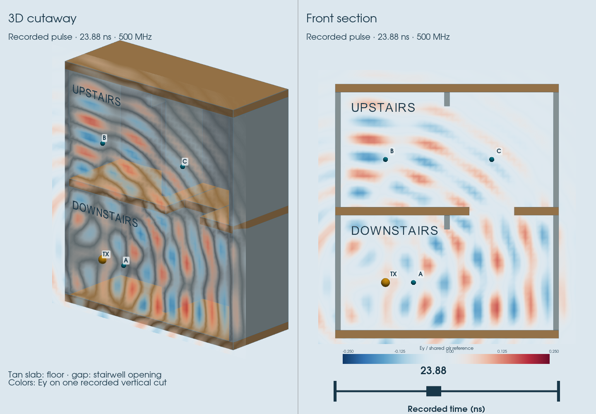
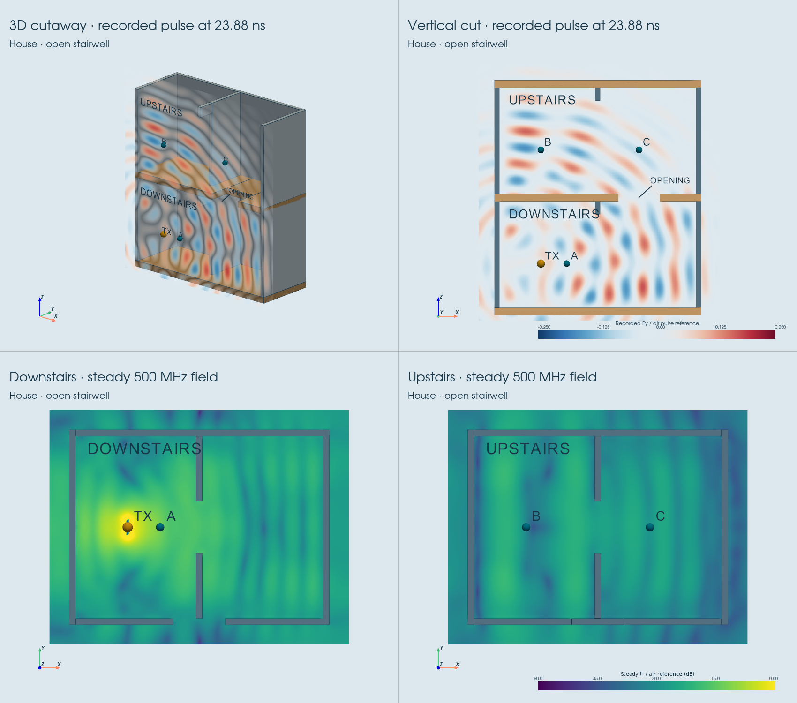
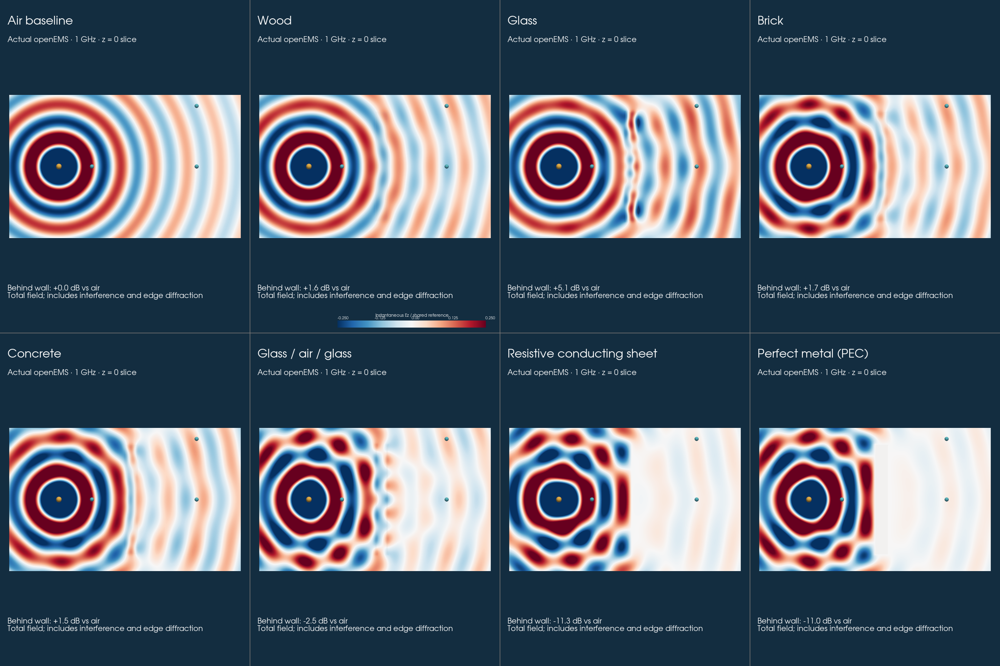
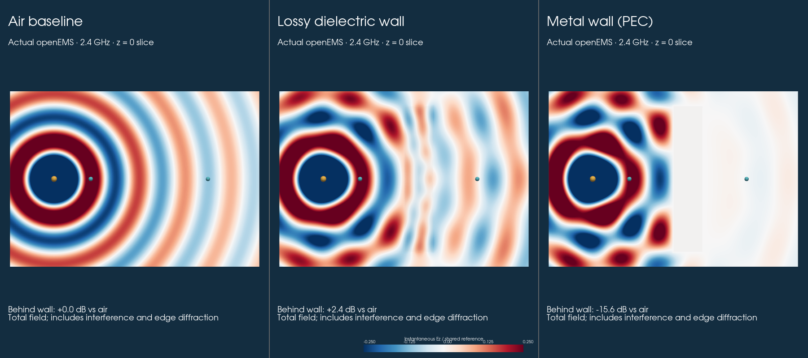
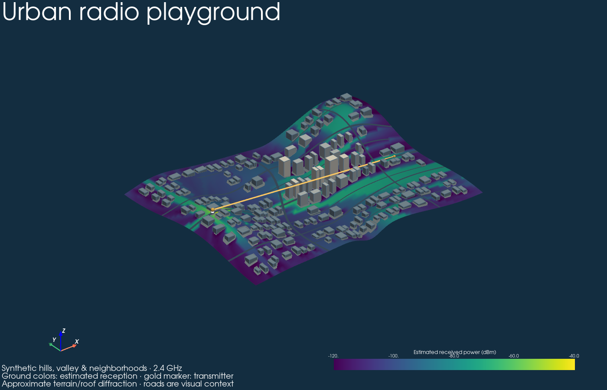
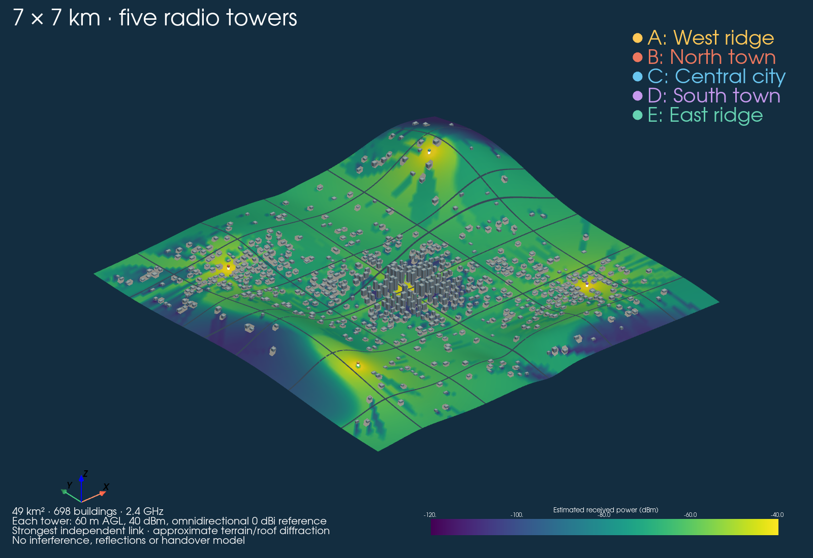
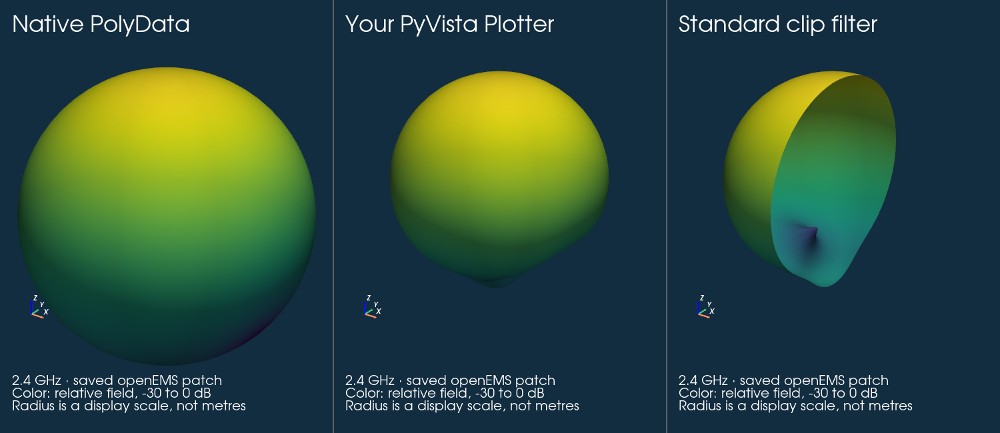

# pyvista-radiation

A third-party **PyVista extension for antenna radiation data**: load complex far
fields, build ordinary PyVista meshes, compare frequencies and extract radiation
cuts. Use it in your own scripts, notebooks and `pyvista.Plotter` scenes.
The bundled openEMS patch dataset runs without a solver installation.

## Install from this checkout

```sh
python3 -m venv .venv
source .venv/bin/activate
pip install -e '.[plot]'
```

The `plot` extra adds PyVista. The `browser` extra adds the optional trame demo;
`preview` remains an alias for those browser dependencies. Data loading and
numerical analysis require only NumPy. This checkout is not published on PyPI.

## Native PyVista integration

```python
import pyvista as pv
from pyvista_radiation import load_patch

plotter = pv.Plotter()
actor = plotter.radiation.add_pattern(load_patch(), index=0)
plotter.radiation.set_frequency(actor, 1)
plotter.show()
```

The installed package registers `radiation` through PyVista's lazy plotter
component API. It adds a native `pyvista.Actor` to your current subplot. Standard
`add_mesh` styling keywords work. `set_frequency(actor, index)` returns the
updated mesh while retaining cameras, color limits and actor appearance.

Ordinary functions work independently of the component:

```python
from pyvista_radiation import load_patch, radiation_mesh, principal_cut

data = load_patch()
mesh = radiation_mesh(data, 1, radial_scale='db', floor_db=-30)
clipped = mesh.clip(normal='x')
angles_deg, relative_field_db = principal_cut(data, 1, plane='xz')
mesh.save('pattern.vtp')
```

Meshes are normal `pyvista.PolyData`, with field magnitude, relative decibels,
display radius, unit directions, frequency and normalization metadata.
The extension does not subclass or modify PyVista's core dataset types.

## Bring your own fields

Use `from_arrays(...)` with complex NumPy fields and explicit angle units,
reference radius and provenance. `load_csv(...)` accepts a documented long-form
complex-field exchange format; `load(...)` / `save(...)` preserve the NPZ contract.
These adapters preserve phase and reject ambiguous units, incomplete grids and
conflicting duplicate samples. Vendor-specific solver exports must be mapped to
the declared convention; the package does not guess gain, calibration or phase.
See [importing fields](docs/importing.rst) and the [data contract](docs/data-contract.md).

## Standalone PyVista showcase

The [review example](examples/house_showcase/README.rst) is a focused native
PyVista script with a 1.5 MB VTK dataset. It loads actual openEMS pulse recordings,
clips the building, slices the walls and updates a shared field mesh with a time
slider. It needs only PyVista and NumPy, without installing this extension or a
solver. All 143 timestamps are preserved; spatial sampling is reduced for display.

```sh
python examples/house_showcase/plot_house_pulse.py
```



See the [review guide](docs/showcase.rst) and the
[draft upstream proposal](docs/upstream-proposal.md).

## Examples and optional browser demo

The **two-floor wave house** shows actual openEMS time samples on a vertical cut,
plus steady field slices downstairs and upstairs. Compare an open stairwell,
a filled middle floor, and air. The browser can replay the recorded pulse or
rotate a PyVista cutaway:

```sh
python examples/two_floor_house.py --browser  # http://127.0.0.1:8769
python examples/two_floor_house.py            # native four-panel PyVista view
```

This compact 4 × 3 m model uses 500 MHz, assumed partitions and wood-class slabs.
It includes 3D transmission, reflection and interference, with no house-specific
mesh convergence or measurement validation. Pulse playback uses saved timestamps;
steady wave phase is a separate reconstruction. See [the house example](docs/house.rst).



The larger **material wave lab** expands the actual openEMS domain to
2.4 × 1.6 × 1 m (20 times the original volume) at 1 GHz. Compare wood, glass,
brick, concrete, a glass/air/glass stack, a thin resistive sheet, PEC, and air.
Bulk coefficients use published ITU material-class examples; these are not
measurements of specific building products.

```sh
python examples/through_wall.py --materials --browser  # http://127.0.0.1:8768
python examples/through_wall.py --materials --phase 90 --screenshot preview/material_lab.png
```

See [the material lab](docs/material-lab.rst) for geometry, assumptions,
source normalization and reproduction. Viewing uses saved openEMS fields;
no solver is needed to explore the native PyVista meshes.



An actual openEMS through-wall experiment compares air, a lossy dielectric slab
and a metal wall. The saved complex fields can be explored in native PyVista
or in a separate interactive viewer, including a steady-state wave-phase cycle:

```sh
python examples/through_wall.py --browser   # http://127.0.0.1:8767
python examples/through_wall.py             # native PyVista comparison
```



This small 3D experiment includes transmission, reflection and edge diffraction.
It uses an assumed dielectric and a numerical dipole; receiver comparisons are
total field changes, not measured building penetration loss or received dBm.
Viewing uses bundled fields and needs no solver. See [the experiment](docs/nearfield.rst)
for the source normalization, validation and Docker reproduction command.

The featured city example combines a winding valley, surrounding hills, roughly
190 buildings, varied neighborhoods and roads in one interactive PyVista scene.
Ground colors show the selected coverage/elevation quantity. Move the transmitter
or change its height and calculate again. Supporting graphs are expandable.

```sh
pip install -e '.[browser]'
pyvista-radiation --environment hillside_city
# Or: python examples/coverage_demo.py
```



```sh
python examples/pyvista_extension.py
python examples/user_arrays.py
# Headless figure + native VTP output:
python examples/pyvista_extension.py --screenshot preview/pyvista_extension.png

pip install -e '.[browser]'
pyvista-radiation                  # radiation comparison at http://127.0.0.1:8766
pyvista-radiation results.npz      # your saved dataset
pyvista-radiation --native         # native frequency comparison
pyvista-radiation --coverage       # city-first hillside showcase
pyvista-radiation --environment metro_network  # 7 × 7 km, five radio towers
```

In the city view, drag to rotate, Shift-drag to pan, and scroll or right-drag
to zoom. The **Zoom in** and **Zoom out** buttons below the model work with
a trackpad or keyboard and preserve your viewing angle. **Reset view** restores
the overview without recalculating coverage.

The regional example has about 700 buildings, hills and three town centers.
Compare the strongest of five towers with individual-tower maps, or color the
ground by the strongest tower. Each link includes approximate terrain/roof
obstruction; the combined map shows maximum received power, without modeling
interference. The five reference antennas are omnidirectional.
Run `python examples/regional_network.py` for the same landscape in native
PyVista, or add `--screenshot preview/regional_network.png` for a saved figure.



For notebooks, install ``pip install -e '.[notebook]'`` into your kernel
environment and open [the notebook walkthrough](examples/pyvista_extension.ipynb).
It uses PyVista's interactive trame backend; a notebook editor is supplied by
your existing Jupyter or VS Code setup.

The browser demonstrates the reusable library with linked surfaces, unit
spheres, frequency sliders/selectors, principal-plane cuts, beamwidths and signed
differences. Native mesh creation does not need the browser dependencies.
The earlier [standalone HTML preview](preview/radiation_patterns.html) is retained.



## Scope and scientific limits

Per-frequency peak normalization compares pattern shapes. Global normalization
compares saved field amplitudes under a shared reference, not gain or efficiency.
Decibel radius is a display scale, never a physical antenna surface or distance.
`directivity()` uses angular integration and is distinct from gain.

The core extension visualizes and analyzes supplied results; it does not run a
full-wave solver. The optional terrain/city layer is an illustrative propagation
example with explicit assumptions. It approximates one dominant terrain/roof
edge and omits reflections, street-corner propagation, wall/rock penetration,
multiple-edge interactions and foliage. Its coverage is not measurement validated.
See [terrain example and limits](docs/terrain.rst).

## Validation and development

```sh
pip install -e '.[preview,dev,docs]'
pytest -q
ruff check src tests examples
sphinx-build -W -b html docs docs/_build/html
python -m build
```

Tests cover analytic fields, coordinates, mesh topology, complex-field imports,
PyVista component discovery/lifecycle, camera retention, native exports and
independent saved openEMS cuts. These checks establish implementation behavior,
not agreement with measured antennas. The reference patch's feed-matching
refinement criterion still fails, as recorded in [validation](docs/validation.rst).

- [Getting started](docs/getting-started.rst)
- [PyVista integration](docs/extension.rst) and [API](docs/api.rst)
- [Examples and normalization](docs/examples.rst)
- [Solver reproduction and attribution](simulations/README.md)

Core library and independently written tooling: MIT. Adapted simulation sources:
GPL-3.0-or-later with attribution under `simulations/`. Generated numerical data:
CC0-1.0. openEMS and CSXCAD are not imported by the library. No release, PyPI
publication or documentation hosting is part of this draft.
