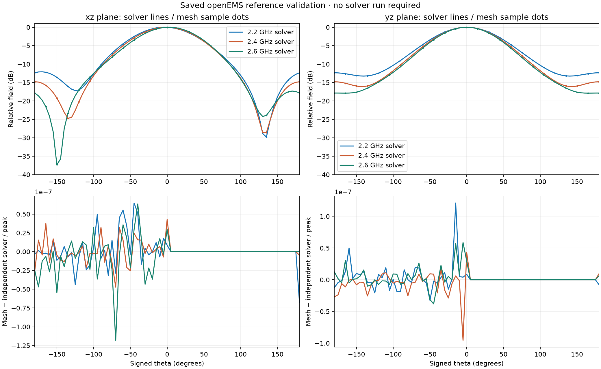

# pyvista-radiation

Load saved antenna far fields, create validated PyVista meshes, and compare
patterns across frequency. The bundled openEMS patch dataset works without a
solver installation.

## Try the comparison

```sh
python3 -m venv .venv
source .venv/bin/activate
pip install -e '.[preview,test]'
pyvista-radiation
```

Open **http://127.0.0.1:8766**. Choose two frequencies and compare their surfaces,
colored unit spheres, and overlaid principal-plane cuts. The decibel radius makes
weak lobes easier to inspect. Controls share color limits and explicitly select
per-frequency or global normalization. Frequency changes retain the camera. Front/back/side presets, an interpolated beamwidth table, and a signed difference map help reveal changes in weaker lobes.

```sh
pyvista-radiation path/to/results.npz  # your saved dataset
pyvista-radiation --native            # native PyVista window with frequency sliders
```

The browser app updates a live Python PyVista scene through trame and renders
with VTK.js. The earlier [standalone HTML preview](preview/radiation_patterns.html)
is also retained and can be opened without a Python server.

## Terrain-aware coverage

The viewer includes approximate signal coverage over synthetic ridges,
mountains, rugged ranges, winding valleys, low-rise city blocks and downtown
towers. Choose an environment and a west/center/east transmitter position.
Terrain and building roofs change calculated path loss through obstruction and
single-dominant-edge diffraction. Change transmitter height, orientation,
frequency or power and compare against the obstruction-loss-disabled baseline.
The map shows received power, additional terrain loss or geometric sight lines.

The landscape is illustrative, and transmit/receive gains are explicit
assumptions. This first model omits multiple-edge interactions, reflections,
through-rock/wall penetration, street-corner propagation and foliage; it is not
measurement validated. City colors show outdoor ground reception, with building
footprints excluded; pale boxes show the buildings.
See [terrain model, limits and real elevation-grid input](docs/terrain.rst).
Local metric terrain NPZ files can be supplied with `pyvista-radiation --terrain terrain.npz`.

## Python API

```python
from pyvista_radiation import load_patch, radiation_mesh, compare_patterns

pattern = load_patch()  # installed package resource, no checkout/solver needed
mesh = radiation_mesh(pattern, 1, mode='pattern')
sphere = radiation_mesh(pattern, 1, mode='sphere')
mesh.save('pattern.vtp')

viewer = compare_patterns(pattern, (0, 2), radial_scale='db', floor_db=-30)
viewer.set_frequency(0, 1)
viewer.show()
```

Core loading requires only NumPy. The `preview` extra installs PyVista, Matplotlib
and trame. Frequency indices refer to the stored `frequency_hz` axis. Mesh points
carry physical field magnitude, relative field dB, display radius and original
unit direction; field data records frequency and normalization reference.

## What the scales mean

- **Per-frequency peak:** compares shapes; every frequency has radius 1 at peak.
- **Global peak:** compares saved amplitudes against the same reference across the
  entire dataset. Feed matching and excitation spectra affect these values;
  this is not a gain or efficiency comparison. The bundled dataset now removes the pulse source spectrum; its calibration is recorded in provenance.
- **Linear radius:** relative field amplitude. **Decibel radius:**
  `(relative_dB - floor_dB) / (-floor_dB)`, a display quantity that reveals weak lobes.
- **Sphere:** unit radius; color alone encodes relative field strength.

Saved complex fields are never normalized or floored. Directivity is available
separately via `directivity()` or `radiation_mesh(..., quantity='directivity')`.
It uses angular power integration and is validated against analytic patterns
and the saved solver result. It does not establish gain or efficiency.

## Validation, docs and distributions

```sh
pytest -q
python examples/validate_patterns.py
python examples/preview.py
pip install -e '.[dev,docs]'
sphinx-build -W -b html docs docs/_build/html
python -m build
```

[Validation overlays](preview/validation.png) compare mesh samples against two
independent solver cuts at all three frequencies. The [error report](preview/validation.json)
records residuals and directivity differences. Analytic tests check orientation,
surface connectivity, poles/seams, normalization and decibels. The patch remains a tutorial reference: the controlled refinement study does
not yet pass the feed-matching convergence criterion, and there is no
measurement validation.



Phases 1–6 are implemented: reproducible reference data; documented data model;
reusable sphere/pattern mesh conversion; analytic and solver validation;
frequency comparison through ordinary plotting functions and a reusable viewer;
installable package, bundled data, Sphinx docs, examples and CI checks. Publishing
the repository changes, docs hosting and a PyPI release remain separate actions.

- [Data contract](docs/data-contract.md)
- [Getting started](docs/getting-started.rst) and [API](docs/api.rst)
- [Examples and normalization](docs/examples.rst)
- [Validation limits](docs/validation.rst)
- [Solver reproduction and attribution](simulations/README.md)
- [Original dataset provenance](data/patch_reference.json)

Core library and independently written tooling: MIT. Adapted simulation script:
GPL-3.0-or-later, with attribution and license under `simulations/`. Generated
numerical data: CC0-1.0. openEMS and CSXCAD are not imported by the library.

Controlled solver sensitivity results and reproduction commands are described in [validation](docs/validation.rst). Raw solver arrays are retained alongside the source-calibrated exchange data.
