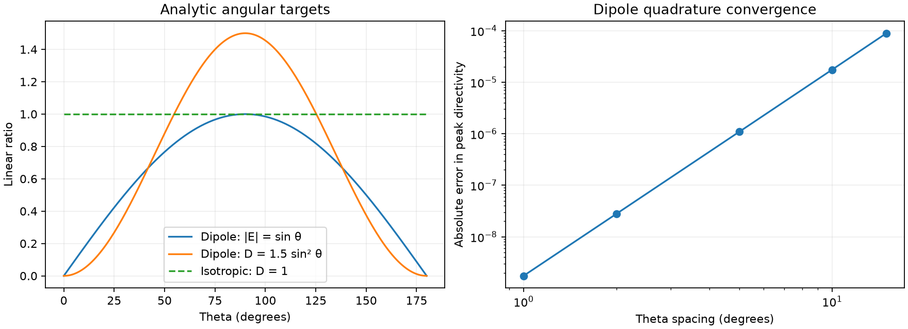

Validation and limits
=====================

Run the tests and regenerate validation figures::

   pytest -q
   python examples/validate_patterns.py

Analytic checks
---------------

Tests use an isotropic angular magnitude and a short z-directed dipole.
The dipole's exact normalized field is ``sin(theta)`` and its directivity is
``1.5 sin(theta)**2``. A deliberately asymmetric ``1 + 0.5 x`` pattern tests
coordinate orientation and ordering independently of the mesh implementation.

Coverage includes cardinal directions; outward triangle winding; unique seam
and pole vertices; Euler characteristic; boundary and nonmanifold edges;
normalization; all-zero fields and nulls; angular endpoints and partial grids;
invalid options; amplitude versus power decibels; immutable physical values;
and frequency updates retaining camera, actors and shared limits.

Saved openEMS checks
--------------------

For all three frequencies and both principal planes, mesh field samples are
compared against separate signed-theta NF2FF calculations. The generated
``preview/validation.json`` records the maximum amplitude errors relative to
each frequency's full-sphere peak. This checks the conversion against the saved
solver output, rather than treating the converter as its own reference.

Angularly integrated peak directivity differs from the saved solver peak by
approximately -0.46%, +0.43%, and +0.93% at 2.2, 2.4, and 2.6 GHz. Tests bound
this difference to 1%. The dataset uses 5° angular sampling and the solver has
its own radiated-power calculation. These values establish limited numerical
agreement, not exact equality or physical measurement validation. The analytic
quadrature-convergence figure shows the sampling dependence separately.

The tutorial uses Mur boundaries and one fixed spatial mesh. The controlled refinement study below does not establish asymptotic
convergence; no measurement comparison or realized-gain calibration has been
performed. Original solver version, mesh XML, raw NF2FF arrays and provenance
are preserved for reproduction and review.

.. image:: _static/validation.png
   :alt: Independent solver cuts compared with mesh samples and residuals

Offline artifacts
-----------------

``examples/preview.py`` writes standalone VTK.js HTML and reference figures.
``examples/validate_patterns.py`` writes mesh/solver overlays, residuals,
analytic targets and an error report. Offline HTML is a saved PyVista scene;
the live comparison app updates a Python PyVista scene through trame.

Excitation calibration and controlled sensitivity checks
--------------------------------------------------------

The initial saved fields retained the pulse's Fourier spectrum. This review
corrected the exchange dataset to a steady response to the tutorial's unit-amplitude temporal source envelope: ``E = E_raw / S(f)`` and
``Prad = Prad_raw / abs(S(f))**2``. The source spectrum is calculated from
``data/raw/excitation.csv`` using the solver's single-sided pulse convention,
``S(f) = 2 dt sum(et(t) exp(-2 pi i f t))``. Raw NF2FF files are preserved.
Calibration factors and the transform convention are recorded in provenance.
This correction changes comparisons of amplitudes across frequencies, while
leaving per-frequency shapes and directivity unchanged. It is not a 1 W
incident-power or realized-gain normalization.

Reproduce the controlled solver checks (outside ordinary CI)::

   docker build -t pyvista-radiation-solver -f simulations/Dockerfile .
   docker run --rm -v "$PWD:/work" pyvista-radiation-solver python3 simulations/run_sensitivity.py
   python examples/sensitivity_report.py

The cases refine free-space mesh spacing from lambda/20 to lambda/25 and
lambda/30, with corresponding patch-edge and substrate refinements; change Mur
to eight-cell PML; enlarge the simulation box by 50%; and double the drive.
The signed principal-plane cuts use 2° sampling at all three frequencies.
Completed runs can be reused (pass ``--force`` after the script name for a
fresh experiment when changing the recipe); runs that hit their time cap are extended to
90,000 timesteps so time truncation does not masquerade as spatial error.
Each case retains its exact geometry, source and log. The report records whether
the decay target was reached and whether the finest pair meets the stated
screening criteria. These experiments measure sensitivity rather than establish
measurement agreement or asymptotic convergence.

Observed refinement limits
--------------------------

The lambda/25 to lambda/30 pair differs by at most 0.223% RMS of peak field in
the sampled cuts and 0.022 dB in sampled-plane peak directivity. The complex
S11 change reaches 0.0333, exceeding the stated 0.02 screening criterion.
Accordingly the report marks the feed-matching refinement criterion as failed.
Boundary and box-size sensitivities are reported independently; no one
experiment is used to assert full convergence.

The excitation-linearity control uses identical 60,000-step windows with a
positive 1e-30 energy threshold, because this packaged solver treats a zero
threshold as its default. The report verifies the actual iteration count from
both logs before evaluating linearity. The earlier adaptively stopped doubled
case is retained as a time-window sensitivity diagnostic.

The PML experiment moves the NF2FF recording surface inward to keep it outside
the absorbing cells; its observed difference includes recording-surface
placement. Enlarging the box also changes the automatically smoothed outer
mesh. These are controlled sensitivity probes, not perfectly isolated error
budgets. Apparent radiated/accepted-power ratios are preserved without clipping;
a value slightly above one exposes numerical error rather than physical gain.

The pulse DFT convention is documented in the upstream
`DFT_time2freq source <https://github.com/thliebig/openEMS/blob/53a426429809ade506828c0aadb550589a115ee5/matlab/DFT_time2freq.m>`_.

The identical-window control passes: the maximum relative field-linearity error
is 2.40e-7 and the radiated-power error is 1.33e-7. Both logs confirm 60,000
iterations; the complex S11 change is below 2.87e-7. This supports consistent
source scaling within this numerical setup, not an absolute realized-gain claim.
